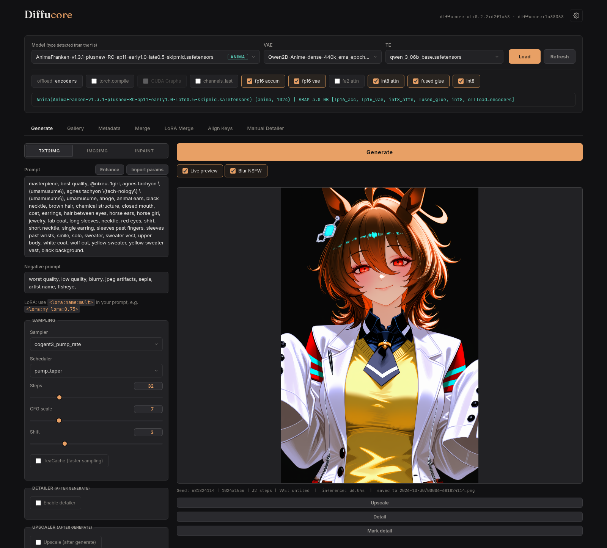

# Diffucore UI

**A local web UI for AI image generation, running on its own inference engine.**




<sub>Anima on an RTX 2060 12 GB: 1024×1536, 32 steps, 36.0 s with the fp16, int8
and fused-glue speed flags on. The tabs after Metadata come from optional
extensions.</sub>

Diffucore UI runs SD 1.5, SDXL, Anima, FLUX, Krea 2 and MOSS-Image from one
browser tab: txt2img, img2img and inpaint in a single workspace, with a
detailer, a tiled upscaler, X/Y/Z sweeps and a gallery that loads any past
image's settings back in. Underneath is
[Diffucore](https://github.com/nawka12/diffucore), an independent PyTorch
engine (not a ComfyUI or AUTO1111 backend) with its own samplers and GPU
kernels, tuned to run well on consumer cards.

## Supported models

| Family | What loads |
|---|---|
| Stable Diffusion 1.5 | `.safetensors` / `.ckpt` checkpoints |
| SDXL | `.safetensors` / `.ckpt` checkpoints |
| Anima | the 2 B DiT (Cosmos-Predict2 based) and the 40-block Anima-2.9B; ComfyUI INT8 files load as-is |
| FLUX | FLUX.1 and FLUX.2 Klein |
| Krea 2 | Raw and Turbo |
| MOSS-Image | 5 B DiT with the Qwen3.5-9B text encoder and the FLUX.2 small VAE |

Every family does txt2img, img2img and inpaint. The model picker detects the
family from the file, so there is no mode to switch.

## Features

**Generating**

- One workspace for txt2img, img2img and inpaint. Switching modes keeps your
  prompt and settings.
- LoRAs straight from the prompt: `<lora:name:0.8>`.
- 35+ samplers and a stack of schedulers (Euler, DPM++, UniPC, ER-SDE, Karras,
  flow and more).
- Live preview of the image forming at every step.
- **Detailer**: finds faces and hands with a YOLO model and re-inpaints each one
  at full resolution, ADetailer style.
- **Tiled upscaler**: 2× or 4× through overlapping low-denoise img2img tiles,
  with an optional ESRGAN base, so big outputs fit in modest VRAM.
- **X/Y/Z sweeps**: a comparison grid across sampler, scheduler, steps, CFG,
  seed or text encoder.
- **Prompt enhance** (Krea 2, Anima): a vision-language model expands a short
  prompt into a detailed one.

**Speed and VRAM**

- Opt-in speed flags per model load: fp16 accumulation, fp16 VAE, int8
  attention, fused Triton kernels, INT8 weights, FlashAttention-2 for RTX
  20-series, torch.compile. The guide lists each one's measured gain and
  trade-off.
- TeaCache (Anima) and a CFG guidance interval (Anima, SD/SDXL) skip work on
  steps that barely change the image.
- Offload mode is picked from your VRAM at startup. The `stream` mode moves the
  model on and off the GPU block by block, aiming to fit SDXL or Anima on a
  ~4 GB card, and VAE decode tiles itself when a full decode won't fit.

**Around the edges**

- **Gallery** grouped by date, with search, a fullscreen carousel and one click
  to load an image's settings back into Generate.
- Every PNG carries its full generation parameters with Civitai-compatible model
  hashes, and the Metadata tab reads AUTO1111, Forge and ComfyUI PNGs too.
- **Several devices at once**: one shared job queue and live event stream keep
  every open tab in sync. `--listen` serves your LAN, `--share` gives a public
  link behind a login token.
- **Extensions** in the AUTO1111/ComfyUI mold: add API routes, generation hooks,
  tabs and panels. For example,
  [diffucore-mecha](https://github.com/nawka12/diffucore-mecha) adds model and
  LoRA merging.

## Requirements

- An NVIDIA GPU. Developed on an RTX 2060 12 GB and also run on an RTX 5090;
  the int8 speed flags need an RTX 20-series or newer.
- Python 3.10 to 3.13, and git.
- Linux is the main platform. Windows has `setup.bat` and `launch.bat`, which
  get less testing.
- Optional: `nvcc` and a C++ compiler. A few speed flags (int8 attention, the
  Turing int8 GEMM) build a CUDA kernel on first load; everything else works
  without them.

## Quick start

```bash
# 1. Clone with submodules, then set up the venv + deps + CUDA torch
git clone --recurse-submodules https://github.com/nawka12/diffucore-ui.git
cd diffucore-ui
./setup.sh                  # Windows: setup.bat

# 2. Drop your model files under models/ (layout below)

# 3. Launch (serves on http://127.0.0.1:7860)
./launch.sh                 # Windows: launch.bat
```

`setup.sh` picks the CUDA build of PyTorch that matches your GPU and driver.
Then open `http://localhost:7860`, pick a model and press **Load**.

```
models/
├── checkpoints/        # SD / SDXL .safetensors or .ckpt (+ FLUX all-in-one)
├── diffusion-models/   # Anima / FLUX / Krea 2 / MOSS-Image DiT
├── vae/                # VAEs for the DiT families
├── text-encoders/      # text encoders for the DiT families
├── loras/              # LoRA adapters
├── detailers/          # YOLO models for the detailer (e.g. face_yolov8n.pt)
└── upscalers/          # ESRGAN-family models for the upscaler (e.g. 4x-UltraSharp.pth)
```

To update later, run `./update.sh` (Windows: `update.bat`).

## Documentation

- **[GUIDE.md](GUIDE.md)**: the full reference. Install details, every mode and
  speed flag with its measured numbers, tips for Anima and Krea 2, network and
  share flags, project structure and architecture.
- **[docs/EXTENSIONS.md](docs/EXTENSIONS.md)**: the extension API, with
  `extensions/example-watermark` as a working reference.

## License

Apache-2.0. See [`LICENSE`](diffucore/LICENSE) and [`NOTICE`](diffucore/NOTICE).
Diffucore is an independent implementation; model architectures and sampling
algorithms are implemented from their original research publications.
